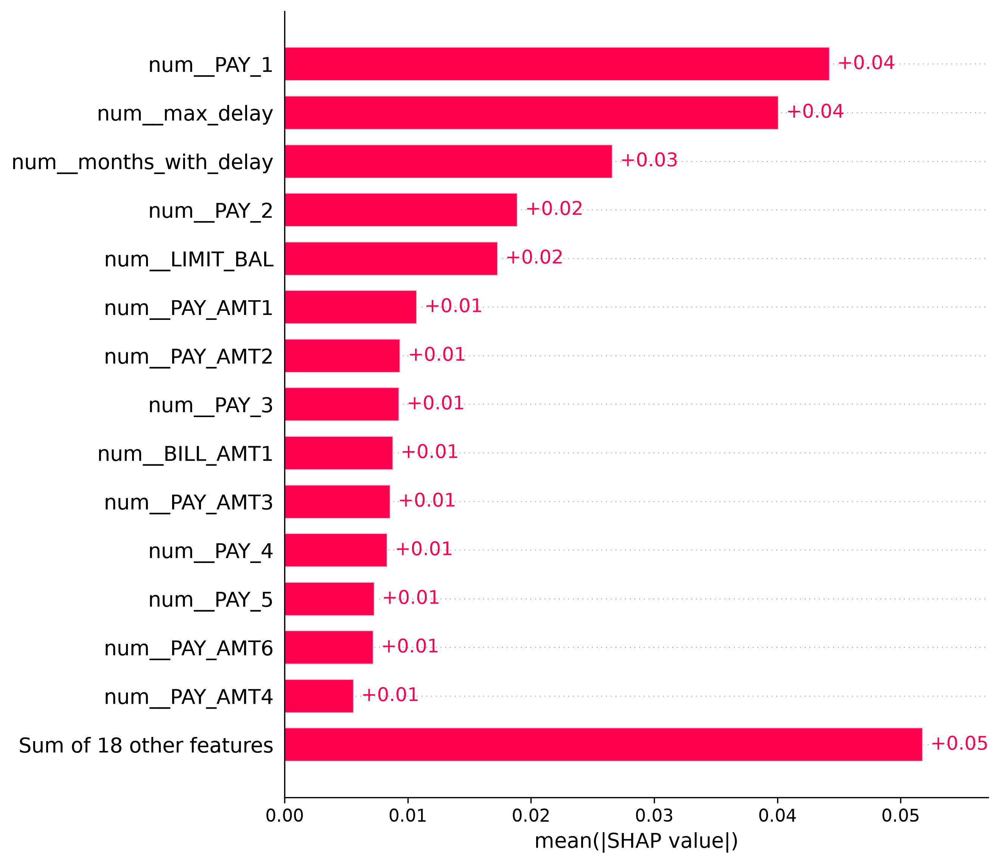
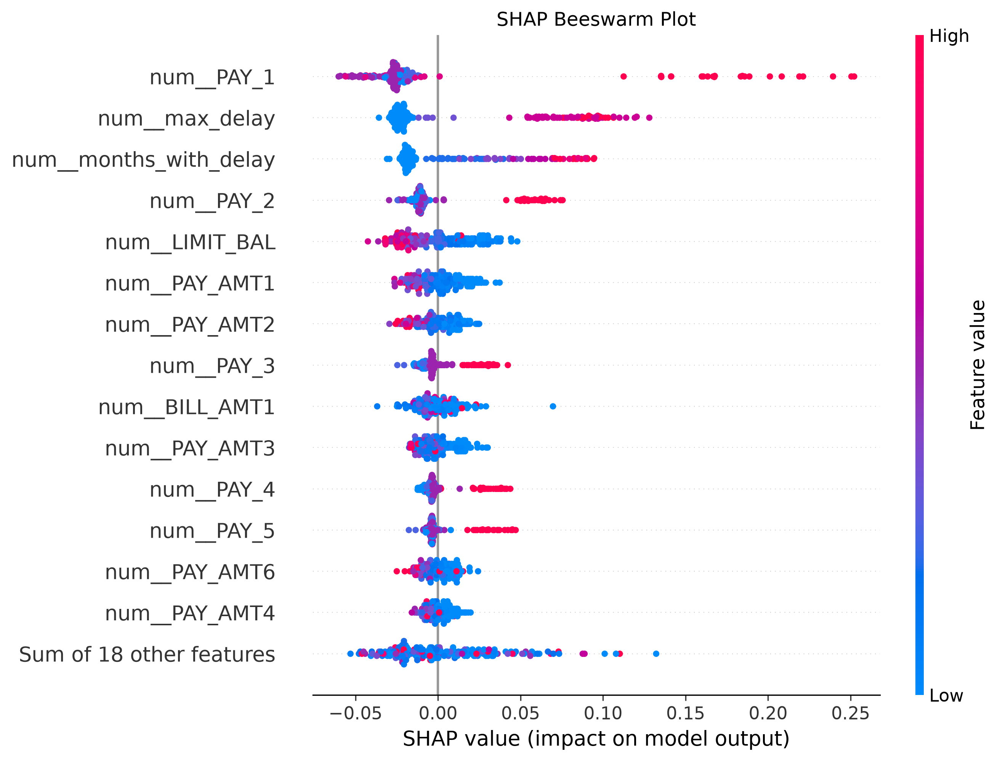
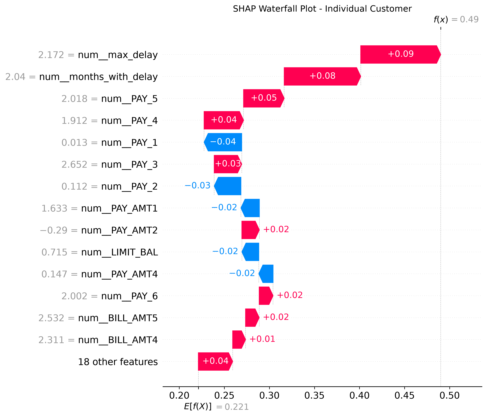

# Model Explainability Using SHAP

## 1. Objective

The objective of this analysis is to understand how the selected machine learning model uses customer financial information and historical repayment behaviour to predict the probability of credit card default in the following month.

In banking and financial services, predictive accuracy alone is insufficient. Credit risk models also need to be understandable, transparent and subject to appropriate validation.

SHAP (SHapley Additive exPlanations) was used to investigate the contributions of individual features to the model's predictions.

The analysis focuses on both global explainability, which examines model behaviour across multiple customers, and local explainability, which explains individual predictions.

## 2. Explainability Methodology

SHAP was applied to the selected classification model using a sample of 200 customer observations from the test dataset.

The model uses customer demographic information, credit limits, historical repayment statuses, billing amounts and previous payment amounts.

Two additional features were engineered:

- **months_with_delay:** The number of historical repayment periods with a positive delay-status code.
- **max_delay:** The maximum positive repayment-delay status code recorded across the six historical periods.

Three SHAP visualisations were generated:

1. Global feature importance plot
2. SHAP beeswarm summary plot
3. Individual customer waterfall plot

Together, these visualisations help explain how the model uses customer information when generating predictions.

## 3. Global Feature Importance

The global SHAP feature importance plot ranks variables according to their average absolute contribution to the model output across the evaluated customers.

The following variables are particularly relevant to interpreting credit default predictions.

### Recent Repayment Status (`PAY_1`)

`PAY_1` represents the customer's most recent recorded repayment-status code.

This variable provides information about recent repayment behaviour, including whether the customer has experienced payment delays.

From a credit risk perspective, recent repayment difficulties can be an important indicator of financial stress.

The SHAP analysis can be used to examine how the model incorporates this information into its predictions.

### Number of Periods With Delayed Repayment (`months_with_delay`)

This engineered feature measures how many of the six historical repayment periods contain a positive delay-status code.

It provides a summary of the frequency of recorded repayment difficulties.

A customer with repeated delays may exhibit a different risk profile from a customer with consistently timely repayments.

SHAP helps examine the influence of this feature on the model's predictions.

### Maximum Repayment Delay (`max_delay`)

`max_delay` represents the highest positive repayment-delay status code observed across the six historical periods.

This feature summarises the most severe recorded repayment-status category for a customer.

It complements `months_with_delay` by capturing the severity of repayment difficulties rather than their frequency alone.

### Credit Limit (`LIMIT_BAL`)

`LIMIT_BAL` represents the customer's credit limit in New Taiwan dollars (NTD).

Credit limits provide information about a customer's available credit facility and may reflect characteristics associated with their financial profile.

SHAP can help identify whether different credit-limit values influence the model output.

### Interpretation

These variables provide useful examples of repayment behaviour and credit information that can be investigated through SHAP.

The final ranking of the most influential variables should be determined from the global importance plot rather than assumed from financial intuition.

## 4. SHAP Beeswarm Analysis

The SHAP beeswarm plot provides a detailed view of how feature values contribute to model predictions across individual customers.

Each point represents a customer observation.

The horizontal position indicates the SHAP contribution to the explained model output, while colour represents the corresponding feature value.

- **Red points:** Generally indicate higher feature values.
- **Blue points:** Generally indicate lower feature values.
- **Positive SHAP values:** Increase the explained model output relative to the baseline.
- **Negative SHAP values:** Decrease the explained model output relative to the baseline.

### Interpretation of Repayment Behaviour

**Recent repayment status (`PAY_1`)**

The beeswarm plot can be used to examine whether higher repayment-delay codes contribute positively to the model's default-risk output.

This is relevant because recent payment difficulties may contain useful information about future repayment behaviour.

**Frequency of delayed repayments (`months_with_delay`)**

This feature captures repeated repayment difficulties across historical periods.

Its SHAP distribution helps assess how the model distinguishes customers with different frequencies of repayment delays.

**Maximum repayment delay (`max_delay`)**

The SHAP values associated with this variable help explain how the model incorporates the severity of previous repayment difficulties.

**Credit limit (`LIMIT_BAL`)**

The beeswarm plot can also show how different credit-limit values contribute to predictions.

The relationship may be complex because credit limits interact with repayment behaviour and other financial characteristics.

### Business Significance

The beeswarm analysis helps analysts investigate whether the model's predictions are influenced by financially meaningful information.

It also helps identify unusual patterns that may require further investigation during model validation.

These interpretations describe model behaviour rather than causal relationships.

## 5. Individual Customer Explanation

The SHAP waterfall plot explains how the model arrives at its output for one selected customer.

The explanation begins with a baseline model output and shows how individual features contribute positively or negatively.

### Factors That May Increase Predicted Default Risk

**Recent repayment delays**

A positive contribution from `PAY_1` would indicate that the customer's recent repayment status increases the model output relative to its baseline.

**Repeated repayment difficulties**

A positive contribution from `months_with_delay` would indicate that the customer's history of delayed repayments increases the explained model output.

**Severity of previous delays**

A positive contribution from `max_delay` would indicate that the maximum historical repayment-delay status increases the model output.

### Factors That May Decrease Predicted Default Risk

**Repayment history**

Certain repayment-status values may contribute negatively to the model output, depending on the fitted model and customer observation.

**Credit limit and payment behaviour**

Variables such as `LIMIT_BAL`, `PAY_AMT1` and other historical payment amounts may contribute negatively or positively, depending on the customer's values and the relationships learned by the model.

### Interpretation

The waterfall plot demonstrates how multiple customer characteristics combine to produce an individual model prediction.

The direction and magnitude of each contribution must be read from the actual waterfall plot.

SHAP contributions may be expressed in raw model-score units rather than probability percentage points, depending on the explainer configuration.

## 6. Business Interpretation

SHAP explainability is relevant to banking because credit risk models must be evaluated not only for predictive performance but also for transparency and appropriate governance.

The analysis provides several potential business benefits.

### Understanding Credit Risk Drivers

SHAP helps investigate the role of repayment history, credit limits and payment behaviour in model predictions.

### Supporting Model Validation

Risk analysts can review whether the model relies on financially meaningful variables and investigate unexpected feature contributions.

### Improving Stakeholder Communication

Visual explanations can make complex model predictions easier to discuss with analysts, managers and model validation teams.

### Investigating Individual Predictions

Waterfall plots allow analysts to examine how a model uses the characteristics of a particular customer.

### Supporting Model Governance

Explainability can contribute to model documentation, challenge and monitoring.

However, SHAP does not establish that a model is fair, compliant or suitable for real-world lending decisions.

## 7. Limitations

Several limitations must be considered when interpreting the SHAP results.

**1. SHAP does not establish causality**

A feature contributing to a prediction does not prove that changing the feature would directly change the customer's likelihood of default.

**2. Correlated features can complicate explanations**

Repayment-status variables and engineered features such as `months_with_delay` and `max_delay` contain related information.

SHAP contributions may therefore be distributed across correlated variables.

**3. SHAP results depend on model configuration**

Explanations depend on the fitted model, preprocessing steps, background data and SHAP explainer.

**4. Limited explanation sample**

The global analysis uses a sample of 200 observations, so the results may not fully represent model behaviour across all customers.

**5. Historical dataset limitations**

The UCI Default of Credit Card Clients dataset contains historical Taiwanese credit card records.

Its customer characteristics and financial environment may differ significantly from those of modern UK banking customers.

**6. Fairness and governance considerations**

Demographic characteristics such as sex and age require careful consideration in credit risk modelling.

SHAP does not replace fairness assessment, discrimination testing, model monitoring or regulatory review.

## 8. Conclusion

SHAP was used to examine both global and individual explanations of the selected credit card default prediction model.

The global feature importance plot provides an overview of influential model variables, while the beeswarm plot illustrates the distribution of feature contributions across customers.

The individual waterfall plot demonstrates how customer information contributes to a specific model prediction.

Repayment-status variables, historical payment behaviour and credit limits are financially meaningful areas for investigation within this credit risk application.

The explainability analysis complements model evaluation and probability calibration by providing additional insight into the model's behaviour.

Overall, this project demonstrates how machine learning and explainable AI techniques can be combined to investigate credit default risk, while recognising the importance of model validation, fairness and responsible use in financial services.